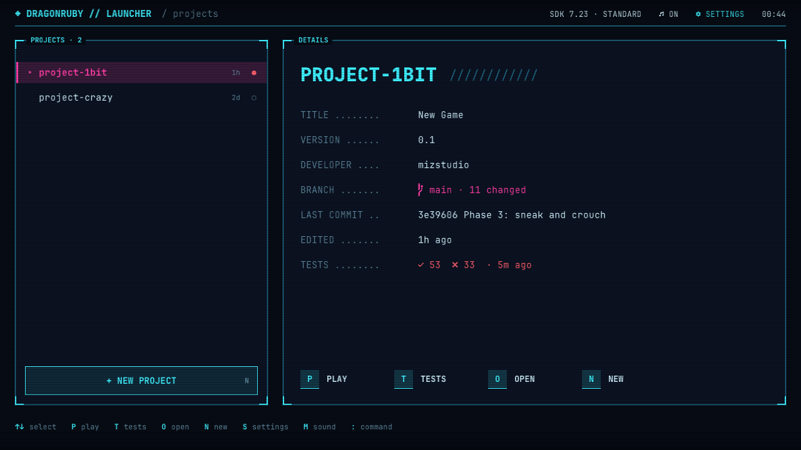
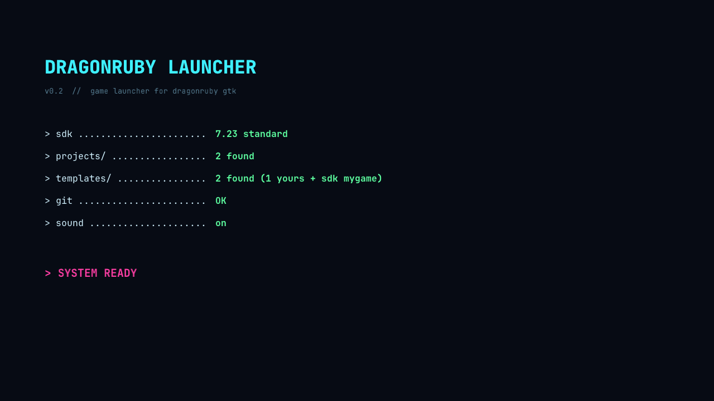
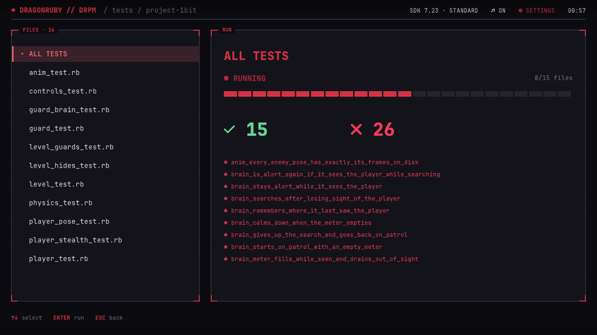
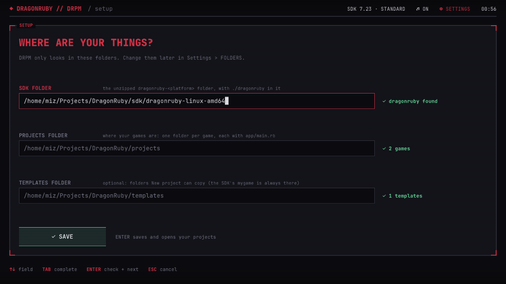
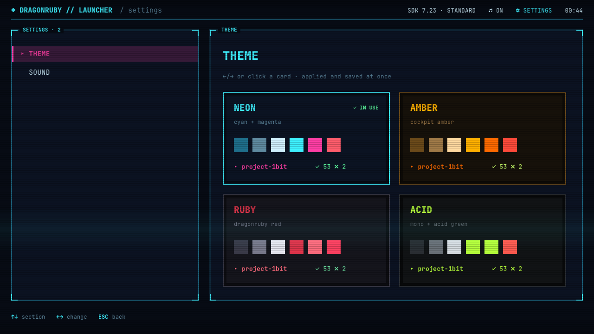
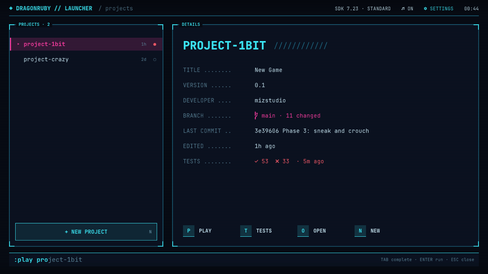
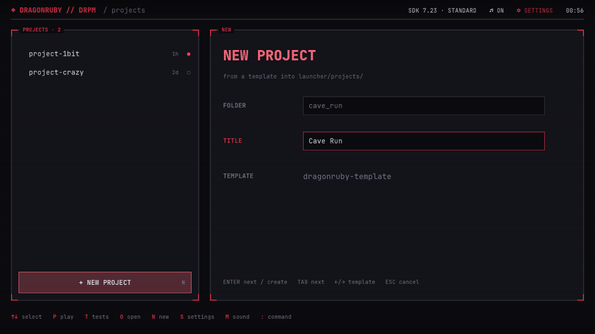

# DRPM — DragonRuby Project Manager

A launcher and project manager for [DragonRuby Game Toolkit](https://dragonruby.org), built in DragonRuby itself.
Pick a game, play it, run its tests, start a new one from a template. No terminal, no links inside the SDK.



## How this happened

I should have been working on my game. Instead, I got tired of going to the terminal every time I wanted to run
or test it, and decided to use the engine to build a launcher and manager for it. Then I used Claude Code to get
the tool running quickly, and couldn't stop adding things: a boot sequence, a command bar, live test runs, four
themes… The game is still waiting.

## What it does

- **Projects** — every game in your projects folder, last edited first, with its title, version, git branch and
  changes, last commit, and last test result.
- **Play** — starts the game in its own window. DRPM keeps running.
- **Tests** — runs one test file or all of them in the background, with no windows. Shows a progress bar, the
  totals and the failed tests. Results are kept between runs.
- **New project** — copies a template into your projects folder, sets `gameid` and `gametitle`, and runs `git init`.
- **Command bar** — `:play`, `:test`, `:open`, `:new`, `:git status`, `:git log`, `:theme`, `:settings`, `:help`, `:quit`,
  with Tab completion.
- **Settings** — four themes (Ruby, Neon, Amber, Acid), sound on/off, and the folders DRPM uses.
- **SDK info** — the header shows the version and license tier of the SDK you pointed it at.

| | |
|---|---|
|  |  |
|  |  |
|  |  |

## Requirements

- **Your own DragonRuby GTK SDK**, any tier (Standard is enough). DRPM never ships the SDK; its license doesn't
  allow sharing it, so you download it from [dragonruby.org](https://dragonruby.org) yourself.
- **Linux** (tested) or **macOS** (supported, not yet tested — reports welcome). Windows isn't supported: DRPM runs
  `sh` commands.
- `git`, plus the usual command-line tools: `tar`, `sed`, `find`, `stat`, and `xdg-open` (Linux) or `open` (macOS).

## Download (Linux)

The quickest way: no cloning, no copying into the SDK.

1. Download `drpm-linux-amd64.zip` from the [latest release](https://github.com/migalvalm/drpm/releases/latest).
2. Unzip it anywhere and run `drpm-linux-amd64.bin` (double-click it, or `./drpm-linux-amd64.bin` in a terminal).
3. On first start, [Setup](#first-run) asks where your DragonRuby SDK and your games are. That's it.

You still need your own DragonRuby SDK: DRPM uses it to run and test your games. The build keeps its settings in
`~/.local/share/DRPM`.

On macOS, there's no download: run DRPM from source, or [build it on your Mac](#macos).

## Setup from source

For macOS, for working on DRPM, or if you'd rather not use a build.

### Run from source

1. Unzip your DragonRuby SDK anywhere, e.g. `~/DragonRuby/sdk/dragonruby-linux-amd64`.
2. Clone this repo anywhere, e.g. `~/DragonRuby/drpm`.
3. Run it from the SDK folder, giving the path to DRPM:

   ```sh
   cd ~/DragonRuby/sdk/dragonruby-linux-amd64
   ./dragonruby ~/DragonRuby/drpm
   ```

DragonRuby runs a game from any path, so neither DRPM nor your games need to be inside the SDK folder.

### First run

DRPM asks where your things are:


| Folder | What it is |
|---|---|
| **SDK folder** | The unzipped `dragonruby-<platform>` folder, with `./dragonruby` in it. |
| **Projects folder** | Where your games are: one folder per game, each with `app/main.rb`. It can be the SDK folder itself, if that's where you keep your games (its own `mygame/` is hidden). |
| **Templates folder** | Optional. Each folder in it is a starting point for New project. The SDK's own `mygame/` is always offered too. |

Fields are checked as you go, Tab completes folder names, and SAVE takes you to your projects.
You can change them later in **Settings → FOLDERS**.

A layout that works well:

```
~/DragonRuby/
  sdk/dragonruby-linux-amd64/
  drpm/
  projects/   my-game/  other-game/
  templates/  my-template/
```

### App menu entry (Linux, optional)

Save as `~/.local/share/applications/drpm.desktop`, with your own paths:

```ini
[Desktop Entry]
Type=Application
Name=DRPM
Exec=sh -c "cd /home/you/DragonRuby/sdk/dragonruby-linux-amd64 && ./dragonruby ../../drpm"
Icon=/home/you/DragonRuby/sdk/dragonruby-linux-amd64/dragonruby.png
Terminal=false
Categories=Development;
```

## Using it

| Key | Does |
|---|---|
| `↑` `↓` | Select a game (the last item is **+ NEW PROJECT**) |
| `P` / `Enter` | Play |
| `T` | Tests |
| `O` | Open the game's folder |
| `N` | New project |
| `S` | Settings |
| `M` | Sound on/off |
| `:` | Command bar (`:help` lists the commands) |
| `Esc` | Back |

The mouse works too: click a game, an action, + NEW PROJECT, or ⚙ SETTINGS in the header.

A test run keeps going if you leave the tests screen. The main screen shows its progress, and a chime (or a low
tone) tells you when it's done.

## Build it yourself

You only need this to make your own build (the Linux one is on the [releases page](https://github.com/migalvalm/drpm/releases)).
DragonRuby's `dragonruby-publish` packages DRPM like any game. It only packages a game that is a real folder
**inside** the SDK folder (not a path elsewhere, and not a link), so copy DRPM in first:

```sh
cd ~/DragonRuby/sdk/dragonruby-linux-amd64
rm -rf drpm && cp -r ~/DragonRuby/drpm drpm && rm -rf drpm/.git drpm/state
./dragonruby-publish --platforms=linux-amd64 --package drpm
```

The packages land in the SDK's `builds/` folder: `drpm-linux-amd64.bin` and `drpm-linux-amd64.zip`.
A build runs from anywhere and shows Setup on first start. It keeps its settings and test results in your
user data folder (`~/.local/share/DRPM` on Linux) instead of `state/`.

### macOS

DRPM's commands support macOS, but there's no macOS build to download. If you want one, **build it on your own
Mac with your macOS SDK**:

```sh
cd ~/DragonRuby/sdk/dragonruby-macos
rm -rf drpm && cp -r ~/DragonRuby/drpm drpm && rm -rf drpm/.git drpm/state
./dragonruby-publish --platforms=macos --package drpm
```

The app isn't signed, so macOS warns you the first time: right-click it and choose **Open**. You can also just run
DRPM from source with `./dragonruby ~/DragonRuby/drpm`.

## Working on DRPM

Run the tests from the SDK folder:

```sh
./dragonruby ~/DragonRuby/drpm --test tests/projects_test.rb
```

The test files are `command_test.rb`, `info_test.rb`, `new_project_test.rb`, `projects_test.rb`, `shell_test.rb`
and `test_run_test.rb`. Scenes aren't unit tested. `rubocop` (config in `.rubocop.yml`) checks the style.

| Where | What |
|---|---|
| `app/shell.rb` | Every shell command DRPM runs, built from the configured folders |
| `app/paths.rb`, `app/settings.rb` | The three folders, theme and sound, saved in `state/settings.txt` |
| `app/projects.rb`, `meta.rb`, `git_info.rb`, `sdk_info.rb` | What DRPM reads about your games and SDK |
| `app/test_run.rb`, `test_log.rb`, `results.rb` | Background test runs and their results |
| `app/theme.rb`, `app/ui/` | Palettes, fonts, HUD drawing and effects |
| `app/scenes/` | Boot, setup, main, tests, settings |
| `tools/make_blips.py` | Generates the UI sounds in `sounds/` |

## Credits and licenses

- DRPM's code: [MIT](LICENSE), © 2026 Miguel Almeida.
- Font: [JetBrainsMono Nerd Font](https://www.nerdfonts.com), SIL Open Font License (`fonts/OFL.txt`).
- Sounds: generated by `tools/make_blips.py`.
- DragonRuby Game Toolkit isn't included; you need your own copy, under its own license.
